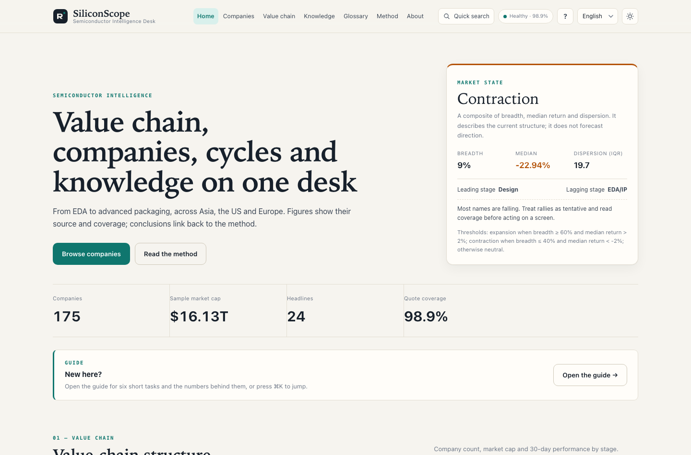
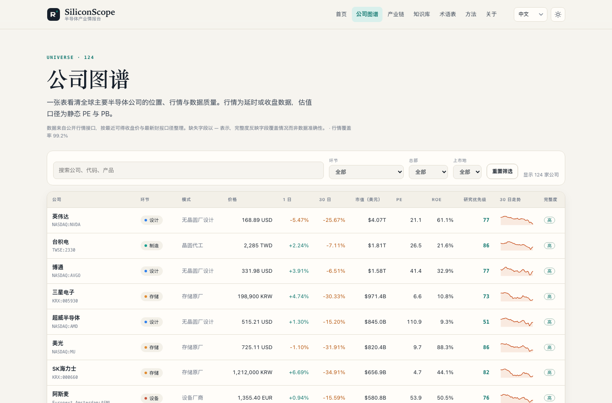
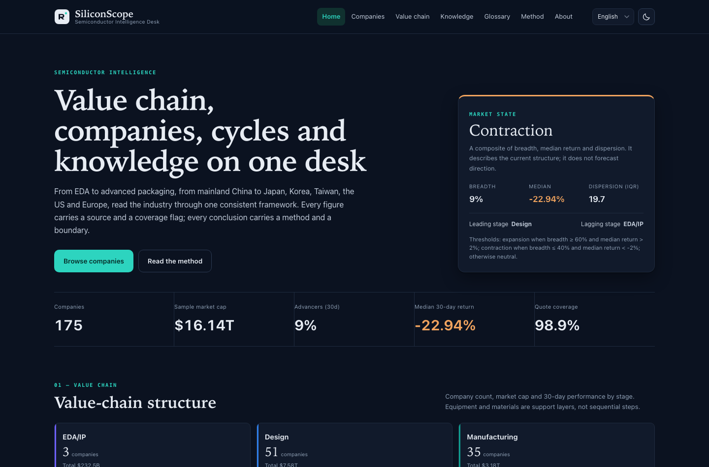
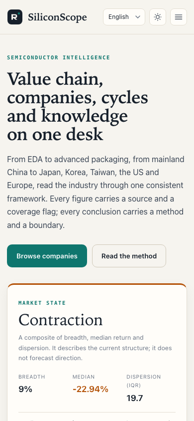
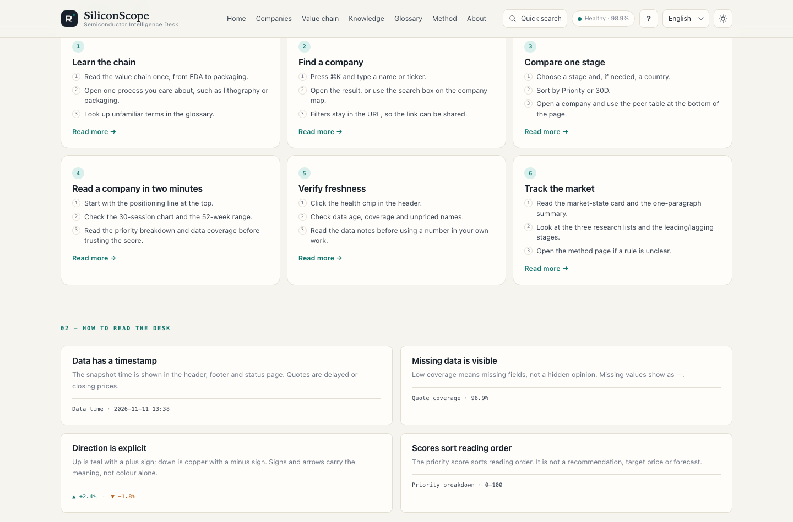
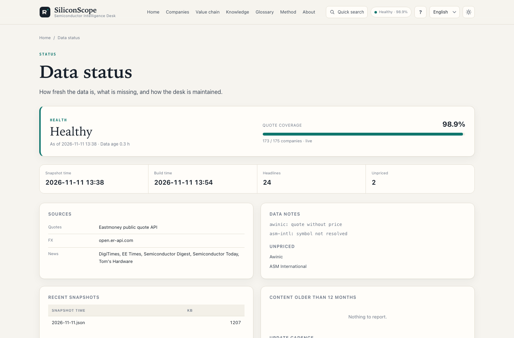

# SiliconScope · Semiconductor Intelligence Desk

**English** · [中文](README_cn.md) · [日本語](README_jp.md) · [Deutsch](README_de.md)

**A four-language research desk for the global semiconductor value chain.**

SiliconScope covers **8 value-chain stages, 13 headquarters regions and 175 listed companies**, putting quotes, structure, knowledge and method on one auditable desk. Every page is a static file generated at build time; the site depends on no CDN and no front-end framework.

- Site (English, default): <https://cxy2696.github.io/semiconductor/>
- 中文: <https://cxy2696.github.io/semiconductor/zh/>
- 日本語: <https://cxy2696.github.io/semiconductor/ja/>
- Deutsch: <https://cxy2696.github.io/semiconductor/de/>
- Repository: <https://github.com/cxy2696/semiconductor>

> For industry research and learning only. Not investment advice.


---

## Purpose

SiliconScope is a static dashboard for the semiconductor value chain. It brings company positions, quotes, long-form notes and the scoring rules together, so a reader can move from the whole chain to a single company without losing the data context.

---

## Preview





| Dark mode | Mobile |
| --- | --- |
|  |  |

| Guide | Data status |
| --- | --- |
|  |  |


---

## Features

- **Home**: market-state readings (breadth / median return / dispersion), value-chain structure, momentum extremes, a valuation-quality scatter, three screens produced by published rules, and industry news.
- **Company map**: 175 companies with filtering and sorting by stage, headquarters and listing market, plus 30-day trends, PE/PB/ROE, research priority and data coverage.
- **Company pages**: positioning, quote, 52-week range, year founded and fiscal year end, factor breakdown, peer comparison and further reading.
- **Value chain**: six main-flow stages plus the equipment and materials support layer, explaining for each segment how it earns money, which metrics matter and who competes in it.
- **Knowledge base**: 12 long-form topics in four languages — value chain, wafer process, lithography, equipment and materials, advanced packaging, memory and HBM, the silicon cycle, policy, financials and valuation, plus the new EDA/IP, automotive and AI data-centre topics.
- **Glossary**: 52 terms with equivalent definitions in four languages, with full-text search and category filters.
- **Method**: factor definitions, weights, thresholds, data coverage, known limitations and disclaimer.
- **Compatibility**: continues to emit the legacy `latest_data.json`, so the existing iOS client decodes it without changes.
- **Guide**: three reading paths, the conventions behind every number and a one-minute site map (`/guide.html`).
- **Quick search**: press ⌘K / Ctrl-K to jump to any company, topic, term or page.
- **Data status**: `/status.html` shows freshness, coverage, sources and data notes; `python -m semcore status` prints the same summary for CI.
- **iOS client**: the SwiftUI app under `ios/` still points at `latest_data.json`; see [`ios/README_en.md`](ios/README_en.md).

## Quick start

```bash
python -m venv .venv
source .venv/bin/activate
pip install -r requirements-dev.txt

# Build from the committed snapshot (no network required)
python -m semcore build
python -m semcore serve --port 8000

# Fetch the latest quotes / FX / news and rebuild
python -m semcore refresh

# Validate the data contract and generated artefacts
python -m semcore validate

# Tests
python -m pytest
```

Build output goes to `docs/`: `docs/index.html` (English), `docs/zh/`, `docs/ja/`, `docs/de/`, `docs/api/`, `docs/latest_data.json`, and redirect stubs under `docs/en/`. The directory is generated and ignored by git; GitHub Actions builds and deploys it.

## Directory layout

```text
semcore/                 Python build tooling (fetch → analyse → render)
  sources/               Eastmoney quotes, RSS news, FX
  analytics.py           factors, research priority, risk flags, market state
  build.py               four-locale static site generation
  validate.py            data contract and artefact validation
  content.py             minimal Markdown renderer and content loading
data/
  universe.csv           175-company master data (part of the source of truth)
  taxonomy.json          stage / role / product / country / market labels (four languages)
  glossary.json          52 terms in four languages
  i18n/{en,zh,ja,de}.json interface copy
  symbols.json           verified company → quote-source symbol mapping
  snapshots/             market snapshots (the only build input)
content/knowledge/       12 topics × 4 languages (flat: <slug>_en.md etc.)
templates/               Jinja2 templates
assets/                  design-system CSS + native JS (no dependencies)
docs/                    generated site (built locally and by CI; ignored by git)
documentation/           product / architecture / data / method / operations docs (four languages)
ios/                     SwiftUI iPhone client
tests/                   pytest suite
```

## iOS client

`ios/` is the original SwiftUI app and still consumes `docs/latest_data.json`. v3 keeps that payload and performs field-level compatibility checks (175 companies, non-null OHLC arrays), so the existing client continues to decode it without changes.

```bash
brew install xcodegen
cd ios && xcodegen generate --spec project.yml
open SemiconductorApp.xcodeproj
```

See [`ios/README_en.md`](ios/README_en.md) for simulator, signing and TestFlight instructions.

## Data and definitions

- **Quotes, valuation, 52-week range**: Eastmoney public quote API (delayed or closing prices).
- **FX**: open.er-api.com, falling back to Eastmoney FX pairs and then to the previous snapshot.
- **Industry news**: whitelisted media RSS feeds; only title, source, date and link are retained.
- **Snapshot**: `data/snapshots/latest.json` is the only build input. A failed fetch does not empty the site; the previous data is marked `stale` and displayed.
- **Classification**: one primary listing per company; each company is assigned to one of 8 stages by its main revenue source. The taxonomy also holds 9 roles, 70 product tags, 13 headquarters regions and 7 listing markets.
- **Company detail**: `data/universe.csv` carries names and notes in four languages, plus optional `founded` and `fiscal_year_end` fields surfaced on company pages.
- Detailed fields, units and limitations are in [`documentation/DATA_en.md`](documentation/DATA_en.md).

## Scoring summary

```text
research priority = 0.30 × quality (ROE percentile)
                  + 0.25 × valuation (inverse static PE percentile)
                  + 0.25 × momentum (30-day return 60% + 52-week range position 40%)
                  + 0.20 × size (log market-cap percentile)
```

- Percentiles are computed within the same stage; stages with fewer than 8 companies fall back to the full sample.
- Missing factors are renormalised by the remaining weights, and data coverage is reported alongside the score.
- Scores are only used to **order reading**; they are not buy/sell advice, target prices or earnings forecasts.

Full formulas, thresholds and limitations are in [`documentation/METHODOLOGY_en.md`](documentation/METHODOLOGY_en.md), or on the site at `/methodology.html`.

## Four languages, English first

- English is the default language at the site root `/` and is the `x-default`.
- Chinese is at `/zh/`, Japanese at `/ja/` and German at `/de/`.
- Every page emits four `hreflang` alternates, and the language switcher keeps the reader on the current page.
- Legacy `/en/` links redirect to the root paths, so old URLs do not break.
- Interface copy lives in `data/i18n/{en,zh,ja,de}.json`; data labels live in `taxonomy.json`; long-form content is flat: `content/knowledge/<slug>_<suffix>.md`.
- CI checks that interface keys, knowledge slugs and glossary fields are complete in all four locales.

## Documentation

English is the canonical source. Every document has four language versions, using the `_en`, `_cn`, `_jp` and `_de` suffixes. `README.md` is the English entry point for GitHub, with `README_en.md` as its copy in the documentation set; the other READMEs are `README_cn.md`, `README_jp.md` and `README_de.md`.

| Document | English | 中文 | 日本語 | Deutsch |
| --- | --- | --- | --- | --- |
| Project README | [README.md](README.md) | [README_cn.md](README_cn.md) | [README_jp.md](README_jp.md) | [README_de.md](README_de.md) |
| Product | [PRODUCT_en](documentation/PRODUCT_en.md) | [PRODUCT_cn](documentation/PRODUCT_cn.md) | [PRODUCT_jp](documentation/PRODUCT_jp.md) | [PRODUCT_de](documentation/PRODUCT_de.md) |
| Architecture | [ARCHITECTURE_en](documentation/ARCHITECTURE_en.md) | [ARCHITECTURE_cn](documentation/ARCHITECTURE_cn.md) | [ARCHITECTURE_jp](documentation/ARCHITECTURE_jp.md) | [ARCHITECTURE_de](documentation/ARCHITECTURE_de.md) |
| Data | [DATA_en](documentation/DATA_en.md) | [DATA_cn](documentation/DATA_cn.md) | [DATA_jp](documentation/DATA_jp.md) | [DATA_de](documentation/DATA_de.md) |
| Method | [METHODOLOGY_en](documentation/METHODOLOGY_en.md) | [METHODOLOGY_cn](documentation/METHODOLOGY_cn.md) | [METHODOLOGY_jp](documentation/METHODOLOGY_jp.md) | [METHODOLOGY_de](documentation/METHODOLOGY_de.md) |
| Operations | [OPERATIONS_en](documentation/OPERATIONS_en.md) | [OPERATIONS_cn](documentation/OPERATIONS_cn.md) | [OPERATIONS_jp](documentation/OPERATIONS_jp.md) | [OPERATIONS_de](documentation/OPERATIONS_de.md) |
| Roadmap | [ROADMAP_en](documentation/ROADMAP_en.md) | [ROADMAP_cn](documentation/ROADMAP_cn.md) | [ROADMAP_jp](documentation/ROADMAP_jp.md) | [ROADMAP_de](documentation/ROADMAP_de.md) |

The same convention applies to knowledge files, which are flat rather than split into language directories: `content/knowledge/eda-ip_en.md`, `content/knowledge/eda-ip_cn.md`, `content/knowledge/eda-ip_jp.md`, `content/knowledge/eda-ip_de.md`.

## Deployment

GitHub Pages is driven by the Actions workflow `.github/workflows/pages.yml`:

1. Repository Settings → Pages → Source: **GitHub Actions**.
2. The workflow runs `python -m semcore refresh` at 08:30 Beijing time each weekday and on manual dispatch, then builds, validates and deploys.
3. If the quote source is unavailable, the workflow still builds from the previous snapshot and marks the data timestamp on the page.

The `SITE_URL` environment variable overrides the canonical domain (default `https://cxy2696.github.io/semiconductor`).

## Contributing

Corrections to data, additions to the glossary and improvements to the documentation are welcome. Please include a verifiable source and state the scope of the change. See [`CONTRIBUTING_en.md`](CONTRIBUTING_en.md).

## Licence

- Code: [MIT](LICENSE)
- Written content: CC BY 4.0
- Quotes and news: copyright remains with the original providers; this site only cites and links to them

When citing, please credit **SiliconScope** and the access date.

---

**Disclaimer**: This site is for industry research and learning only and does not constitute any recommendation to buy or sell securities. Data may be delayed or incorrect; always defer to exchange filings and company announcements.
