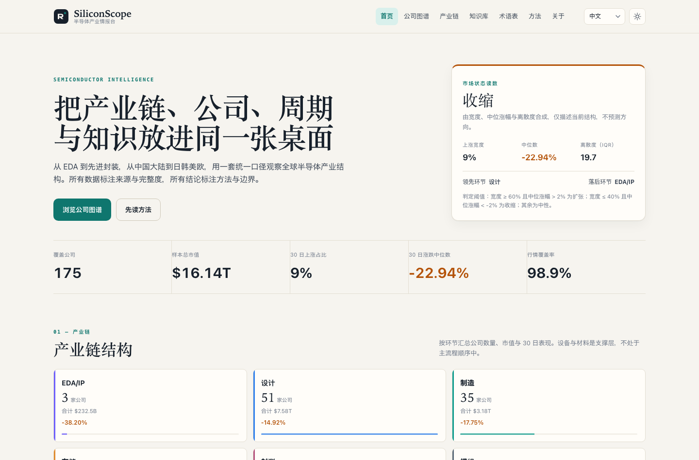
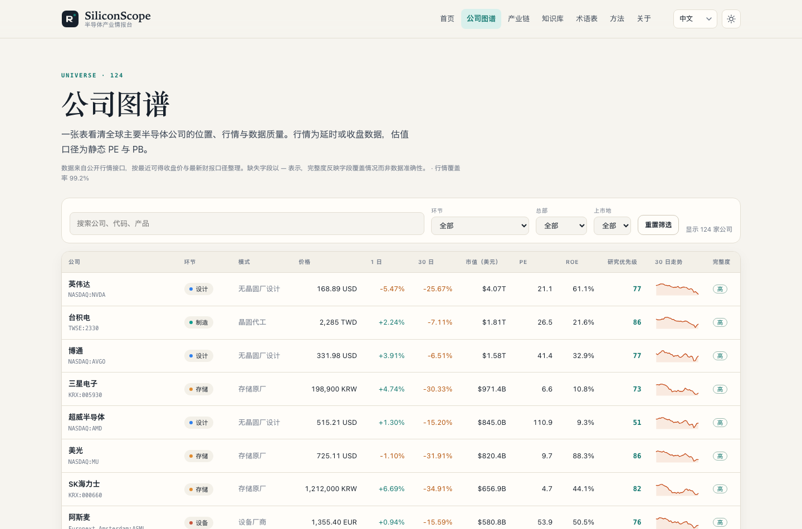
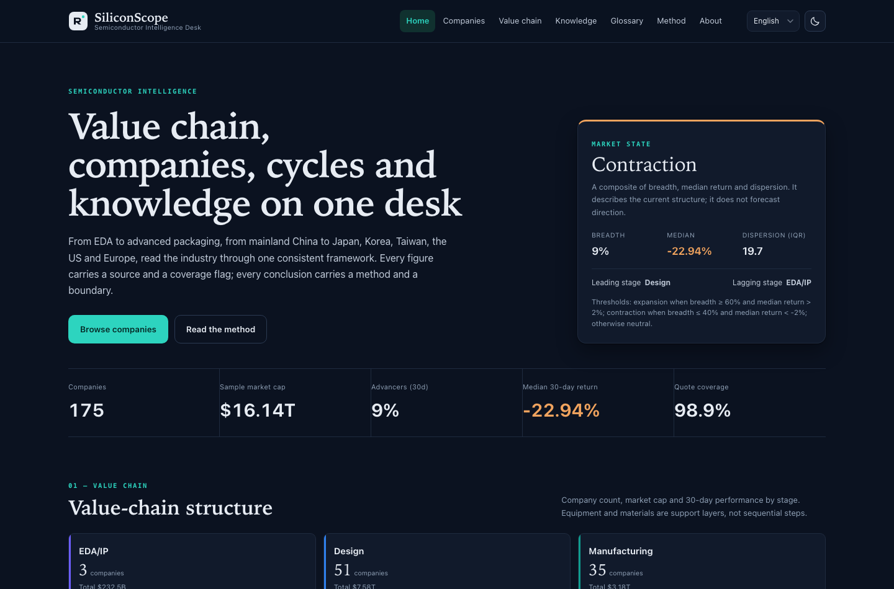
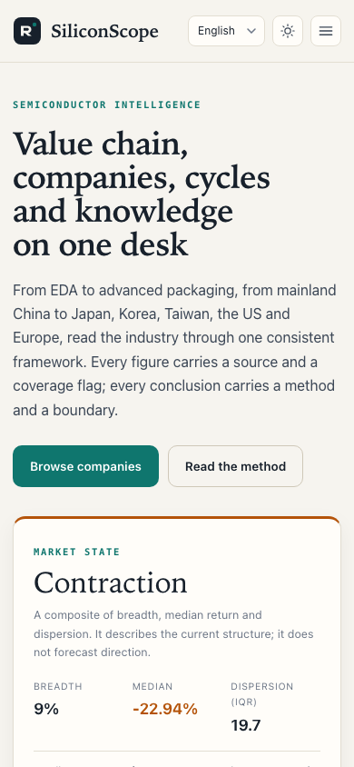
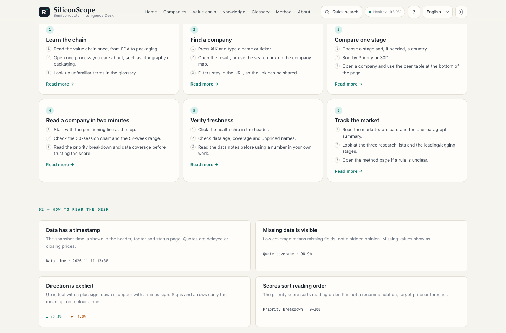
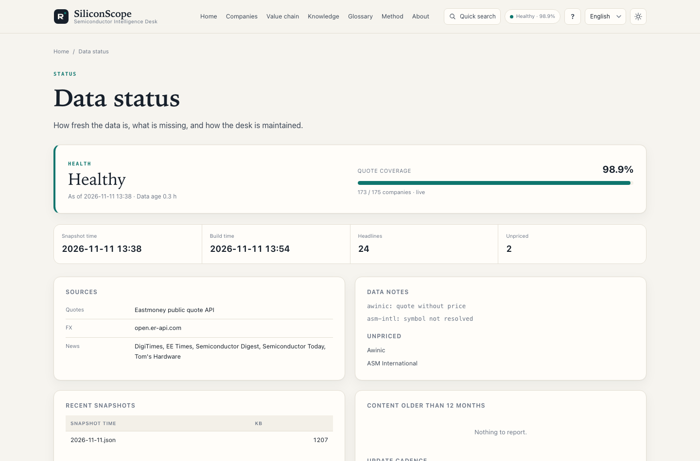

# SiliconScope · 半导体产业情报台

[English](README.md) · **中文** · [日本語](README_jp.md) · [Deutsch](README_de.md)

**全球半导体产业链的四语研究看板** · A four-language research desk for the global semiconductor value chain.

覆盖 **8 个产业链环节、13 个总部地区、175 家上市公司**。把公司位置、行情、长文说明与评分规则放在一起，方便从整条链走到单家公司。所有页面为构建期生成的静态文件，不依赖任何 CDN 或前端框架。

- 站点（默认英文）：<https://cxy2696.github.io/semiconductor/>
- 中文站点：<https://cxy2696.github.io/semiconductor/zh/>
- 仓库：<https://github.com/cxy2696/semiconductor>

> 仅用于产业研究与学习，不构成投资建议。Not investment advice.


---

## 预览





| 深色模式 | 移动端 |
| --- | --- |
|  |  |

| 指南 | 数据状态 |
| --- | --- |
|  |  |


---

## 功能

- **首页**：市场状态读数（宽度 / 中位涨幅 / 离散度）、产业链结构、动能两端、估值-质量散点、三个公开规则生成的研究清单、行业动态。
- **公司图谱**：175 家公司，可按环节、总部、上市地筛选与排序，附 30 日走势、PE/PB/ROE、研究优先级与数据完整度。
- **公司页**：定位、行情、52 周区间、成立年份与财年、因子拆解、同环节对比、延伸阅读。
- **产业链**：主流程 6 个环节 + 设备/材料支撑层，逐段解释“怎么赚钱、看什么指标、谁在里面”。
- **知识库**：12 篇四语长文——产业链、晶圆工艺、光刻、设备材料、先进封装、存储与 HBM、硅周期、政策、财务估值，以及新增的 EDA/IP、汽车半导体、AI 数据中心芯片。
- **术语表**：52 条四语对照术语，支持搜索与分类筛选。
- **方法**：因子定义、权重、阈值、数据完整度、已知局限与免责声明。
- **指南**：三条阅读路径、每个数字背后的约定与一分钟站点地图（`/zh/guide.html`）。
- **快速搜索**：按 ⌘K / Ctrl-K 跳转到任意公司、主题、术语或页面。
- **数据状态**：`/zh/status.html` 展示新鲜度、覆盖率、来源与异常；`python -m semcore status` 输出同一份摘要。
- **兼容**：继续输出旧版 `latest_data.json`，现有 iOS 客户端无需改动即可解码。
- **iOS 客户端**：`ios/` 保留 SwiftUI 应用，说明见 [`ios/README_cn.md`](ios/README_cn.md)。

## 快速开始

```bash
python -m venv .venv
source .venv/bin/activate
pip install -r requirements-dev.txt

# 用仓库内快照构建（无需联网）
python -m semcore build
python -m semcore serve --port 8000

# 抓取最新行情 / 汇率 / 资讯并重建
python -m semcore refresh

# 校验数据契约与产物
python -m semcore validate

# 测试
python -m pytest
```

构建产物在 `docs/`：`docs/index.html`（英文）、`docs/zh/`、`docs/ja/`、`docs/de/`、`docs/api/`、`docs/latest_data.json`。该目录由构建生成并已被 git 忽略，由 GitHub Actions 构建与部署。

## 目录结构

```text
semcore/                 Python 构建工具（抓取 → 分析 → 渲染）
  sources/               东方财富行情、RSS 资讯、汇率
  analytics.py           因子、研究优先级、风险标签、市场状态
  build.py               四语静态站点生成
  validate.py            数据契约与产物校验
content/knowledge/       12 个主题 × 4 种语言（<slug>_en.md 等）
data/
  universe.csv           公司主数据（175 行，含成立年份 / 财年）
  taxonomy.json          环节 / 角色 / 产品 / 国家 / 市场标签（四语）
  glossary.json          52 条四语术语
  i18n/{en,zh,ja,de}.json 界面文案
  symbols.json           公司 → 行情源代码的已核验映射
  snapshots/             行情快照（构建的唯一输入）
templates/               Jinja2 模板
assets/                  设计系统 CSS + 原生 JS（无依赖）
docs/                    构建产物（本地与 CI 生成，已被 git 忽略）
documentation/           产品 / 架构 / 数据 / 方法 / 运营文档（四语）
ios/                     SwiftUI iPhone 客户端
tests/                   pytest 测试
```

## 四语与英文优先

- 英文为默认语言，位于站点根路径 `/`，也是 `x-default`。
- 中文 `/zh/`、日文 `/ja/`、德文 `/de/`。
- 每页输出四个 `hreflang`，语言切换保留当前页面。
- 旧版 `/en/` 链接自动重定向到根路径，避免断链。
- 所有 Markdown 文档使用统一后缀：`README_en.md`、`README_cn.md`、`README_jp.md`、`README_de.md`；知识库同理（`content/knowledge/<slug>_<lang>.md`）。
- CI 校验四种语言的界面键、知识主题、术语字段与文档后缀是否齐全，缺一即失败。

## iOS 客户端

`ios/` 仍消费 `docs/latest_data.json`。v3 保留该 payload 并做字段级兼容校验（175 家公司、K 线数组无空值），现有客户端无需改动即可解码。

```bash
brew install xcodegen
cd ios && xcodegen generate --spec project.yml
open SemiconductorApp.xcodeproj
```

详见 [`ios/README_cn.md`](ios/README_cn.md)。

## 数据与口径

- **行情、估值、52 周区间**：东方财富公开行情接口（延时或收盘价）。
- **汇率**：open.er-api.com，失败时回退东方财富汇率对，再失败复用上一份快照。
- **行业动态**：白名单媒体 RSS，只保留标题、来源、日期与链接。
- **快照**：`data/snapshots/latest.json` 是构建的唯一输入。抓取失败不会让站点变空，而是把上一份数据标记为 `stale` 并显示。
- **分类**：每家公司只保留一个主上市地，按主要收入来源归入 8 个环节之一。
- 详细字段、单位与限制见 [`documentation/DATA_cn.md`](documentation/DATA_cn.md)。

## 评分逻辑（摘要）

```text
研究优先级 = 0.30 × 质量(ROE 百分位)
           + 0.25 × 估值(静态 PE 倒数百分位)
           + 0.25 × 动能(30 日涨跌 60% + 52 周区间位置 40%)
           + 0.20 × 规模(log 市值百分位)
```

- 百分位在同一环节内计算；环节样本少于 8 家时退回全样本。
- 缺失因子按剩余权重重新归一，分数旁边同时展示数据完整度。
- 分数只用于**安排阅读顺序**，不是买卖建议、目标价或盈利预测。

完整公式、阈值与局限见 [`documentation/METHODOLOGY_cn.md`](documentation/METHODOLOGY_cn.md)，或站内 `/zh/methodology.html`。

## 文档

每份文档提供四个语言版本：

| 文档 | English | 中文 | 日本語 | Deutsch |
| --- | --- | --- | --- | --- |
| 项目说明 | [README_en.md](README_en.md) | [README_cn.md](README_cn.md) | [README_jp.md](README_jp.md) | [README_de.md](README_de.md) |
| 产品 | [PRODUCT_en](documentation/PRODUCT_en.md) | [PRODUCT_cn](documentation/PRODUCT_cn.md) | [PRODUCT_jp](documentation/PRODUCT_jp.md) | [PRODUCT_de](documentation/PRODUCT_de.md) |
| 架构 | [ARCHITECTURE_en](documentation/ARCHITECTURE_en.md) | [ARCHITECTURE_cn](documentation/ARCHITECTURE_cn.md) | [ARCHITECTURE_jp](documentation/ARCHITECTURE_jp.md) | [ARCHITECTURE_de](documentation/ARCHITECTURE_de.md) |
| 数据 | [DATA_en](documentation/DATA_en.md) | [DATA_cn](documentation/DATA_cn.md) | [DATA_jp](documentation/DATA_jp.md) | [DATA_de](documentation/DATA_de.md) |
| 方法 | [METHODOLOGY_en](documentation/METHODOLOGY_en.md) | [METHODOLOGY_cn](documentation/METHODOLOGY_cn.md) | [METHODOLOGY_jp](documentation/METHODOLOGY_jp.md) | [METHODOLOGY_de](documentation/METHODOLOGY_de.md) |
| 运营 | [OPERATIONS_en](documentation/OPERATIONS_en.md) | [OPERATIONS_cn](documentation/OPERATIONS_cn.md) | [OPERATIONS_jp](documentation/OPERATIONS_jp.md) | [OPERATIONS_de](documentation/OPERATIONS_de.md) |
| 路线图 | [ROADMAP_en](documentation/ROADMAP_en.md) | [ROADMAP_cn](documentation/ROADMAP_cn.md) | [ROADMAP_jp](documentation/ROADMAP_jp.md) | [ROADMAP_de](documentation/ROADMAP_de.md) |

## 部署

GitHub Pages 使用 Actions 工作流 `.github/workflows/pages.yml`：

1. 仓库 Settings → Pages → Source 选择 **GitHub Actions**。
2. 工作流在每日 08:30（北京时间）与手动触发时运行 `python -m semcore refresh`，随后构建、校验、部署。
3. 若行情源不可用，工作流仍会用上一份快照完成构建，并在页面标注数据时点。

`SITE_URL` 环境变量可覆盖 canonical 域名（默认 `https://cxy2696.github.io/semiconductor`）。

## 参与

数据修正、术语补充、文档改进都欢迎。请附可核查来源，并说明影响范围。见 [`CONTRIBUTING_cn.md`](CONTRIBUTING_cn.md)。

## 许可

- 代码：[MIT](LICENSE)
- 文字内容：CC BY 4.0
- 行情与新闻：版权归原始提供方，本站仅做引用与链接

引用请注明 **SiliconScope** 与访问日期。

---

**免责声明**：本站仅用于产业研究与学习，不构成任何证券买卖建议。数据可能存在延迟或错误，请以交易所与公司公告为准。
