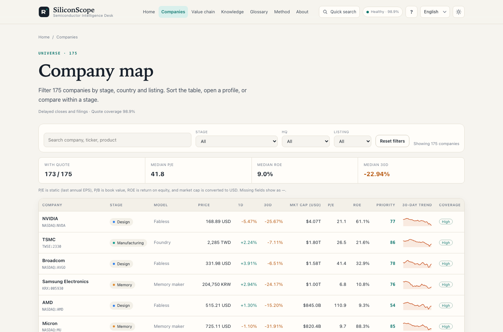
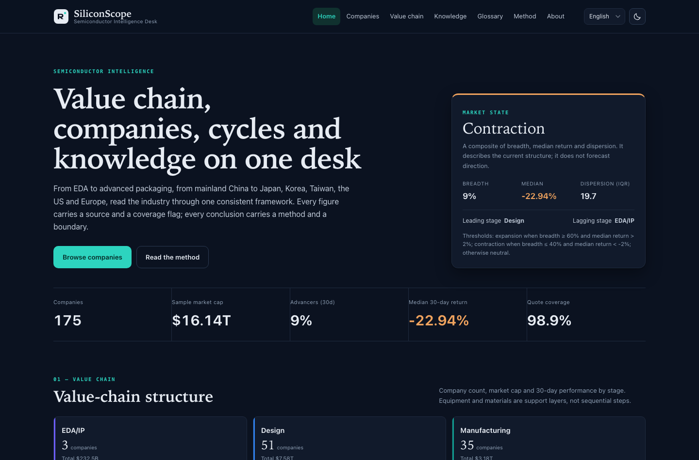
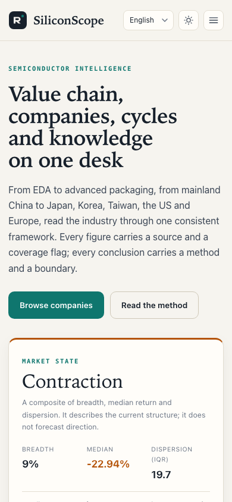
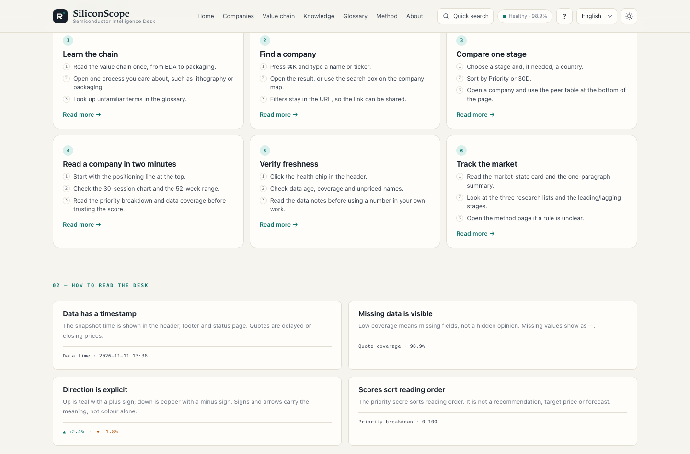
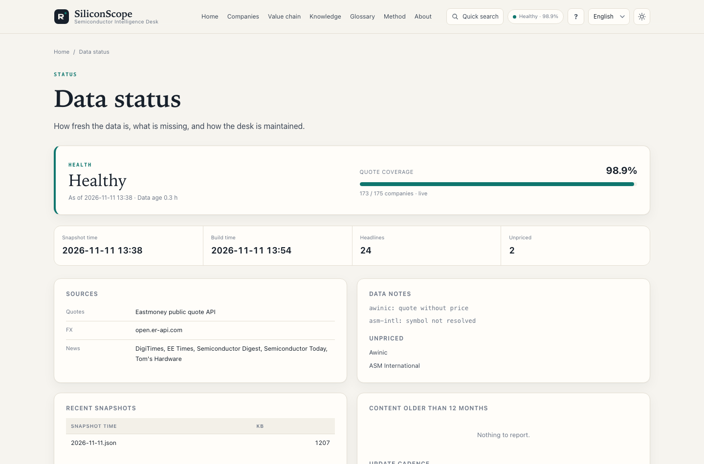

# SiliconScope · Halbleiter-Intelligence-Desk

[English](README.md) · [中文](README_cn.md) · [日本語](README_jp.md) · **Deutsch**

**Ein viersprachiger Research-Desk für die globale Halbleiter-Wertschöpfungskette.**

SiliconScope deckt **8 Wertschöpfungsstufen, 13 Hauptsitzregionen und 175 börsennotierte Unternehmen** ab und bringt Kurse, Struktur, Wissen und Methodik auf einen prüfbaren Desk. Jede Seite ist eine zur Build-Zeit erzeugte statische Datei; die Site benötigt weder ein CDN noch ein Frontend-Framework.

- Website (Englisch, Standard): <https://cxy2696.github.io/semiconductor/>
- Chinesisch: <https://cxy2696.github.io/semiconductor/zh/>
- Japanisch: <https://cxy2696.github.io/semiconductor/ja/>
- Deutsch: <https://cxy2696.github.io/semiconductor/de/>
- Repository: <https://github.com/cxy2696/semiconductor>

> Nur für Branchenrecherche und Lernen. Keine Anlageberatung.


---

## Zweck

SiliconScope ist ein statisches Dashboard für die Halbleiter-Wertschöpfungskette. Es bündelt Unternehmenspositionen, Kurse, ausführliche Notizen und die Scoring-Regeln, sodass man von der gesamten Kette zu einem einzelnen Unternehmen wechseln kann, ohne den Datenkontext zu verlieren.

---

## Vorschau




| Dark Mode | Mobil |
| --- | --- |
|  |  |

| Leitfaden | Datenstatus |
| --- | --- |
|  |  |

---

## Funktionen

- **Startseite**: Messwerte zur Marktlage (Marktbreite / Median-Rendite / Streuung), Struktur der Wertschöpfungskette, Momentum-Extreme, ein Streudiagramm zu Bewertung und Qualität, drei nach veröffentlichten Regeln erzeugte Screens sowie Branchennachrichten.
- **Unternehmenskarte**: 175 Unternehmen mit Filter- und Sortierfunktionen nach Stufe, Hauptsitz und Börsenmarkt, dazu 30-Tage-Trends, KGV/KBV/ROE, Research-Priorität und Datenabdeckung.
- **Unternehmensseiten**: Positionierung, Kurs, 52-Wochen-Spanne, Gründungsjahr und Geschäftsjahresende, Faktoraufschlüsselung, Peer-Vergleich und weiterführende Lektüre.
- **Wertschöpfungskette**: sechs Stufen des Hauptflusses plus die Unterstützungsstufe für Ausrüstung und Materialien; für jedes Segment wird erklärt, wie es Geld verdient, welche Kennzahlen zählen und wer darin konkurriert.
- **Wissensbasis**: 12 ausführliche Themen in vier Sprachen – Wertschöpfungskette, Waferprozess, Lithografie, Ausrüstung und Materialien, Advanced Packaging, Speicher und HBM, Silizium-Zyklus, Politik, Finanzen und Bewertung sowie die neuen Themen EDA/IP, Automotive und KI-Rechenzentren.
- **Glossar**: 52 Begriffe mit gleichwertigen Definitionen in vier Sprachen, mit Volltextsuche und Kategoriefiltern.
- **Methodik**: Faktordefinitionen, Gewichtungen, Schwellenwerte, Datenabdeckung, bekannte Grenzen und Haftungsausschluss.
- **Leitfaden**: sechs praktische Aufgaben, eine Seitentabelle, FAQ und die Konventionen hinter jeder Zahl (`/de/guide.html`).
- **Schnellsuche**: ⌘K / Strg-K springt zu jedem Unternehmen, Thema, Begriff oder jeder Seite.
- **Datenstatus**: `/de/status.html` zeigt Aktualität, Abdeckung, Quellen und Hinweise; `python -m semcore status` liefert dieselbe Zusammenfassung für CI.
- **Kompatibilität**: Das Legacy-`latest_data.json` wird weiterhin ausgegeben, sodass der bestehende iOS-Client es ohne Änderungen dekodieren kann.
- **iOS-Client**: Die SwiftUI-App unter `ios/` verweist weiterhin auf `latest_data.json`; siehe [`ios/README_de.md`](ios/README_de.md).

## Schnellstart

```bash
python -m venv .venv
source .venv/bin/activate
pip install -r requirements-dev.txt

# Build from the committed snapshot (no network required)
python -m semcore build
python -m semcore serve --port 8000

# Fetch the latest quotes / FX / news and rebuild
python -m semcore refresh

# Validate the data contract and generated artefacts
python -m semcore validate

# Tests
python -m pytest
```

Die Build-Ausgabe liegt in `docs/`: `docs/index.html` (Englisch), `docs/zh/`, `docs/ja/`, `docs/de/`, `docs/api/`, `docs/latest_data.json` sowie Weiterleitungsstubs unter `docs/en/`. Das Verzeichnis wird generiert und von git ignoriert; GitHub Actions baut und deployt es.

## Verzeichnisstruktur

```text
semcore/                 Python build tooling (fetch → analyse → render)
  sources/               Eastmoney quotes, RSS news, FX
  analytics.py           factors, research priority, risk flags, market state
  build.py               four-locale static site generation
  validate.py            data contract and artefact validation
  content.py             minimal Markdown renderer and content loading
data/
  universe.csv           175-company master data (part of the source of truth)
  taxonomy.json          stage / role / product / country / market labels (four languages)
  glossary.json          52 terms in four languages
  i18n/{en,zh,ja,de}.json interface copy
  symbols.json           verified company → quote-source symbol mapping
  snapshots/             market snapshots (the only build input)
content/knowledge/       12 topics × 4 languages (flat: <slug>_en.md etc.)
templates/               Jinja2 templates
assets/                  design-system CSS + native JS (no dependencies)
docs/                    generierte Website (lokal und in CI erzeugt, von git ignoriert)
documentation/           product / architecture / data / method / operations docs (four languages)
ios/                     SwiftUI iPhone client
tests/                   pytest suite
```

## iOS-Client

`ios/` ist die ursprüngliche SwiftUI-App und nutzt weiterhin `docs/latest_data.json`. v3 behält dieses Payload bei und führt Kompatibilitätsprüfungen auf Feldebene durch (175 Unternehmen, OHLC-Arrays ohne Nullwerte), sodass der bestehende Client es weiterhin ohne Änderungen dekodieren kann.

```bash
brew install xcodegen
cd ios && xcodegen generate --spec project.yml
open SemiconductorApp.xcodeproj
```

Anleitungen für Simulator, Signierung und TestFlight finden Sie in [`ios/README_de.md`](ios/README_de.md).

## Daten und Definitionen

- **Kurse, Bewertung, 52-Wochen-Spanne**: öffentliche Kurs-API von Eastmoney (verzögerte Kurse oder Schlusskurse).
- **Wechselkurse**: open.er-api.com, mit Fallback auf Eastmoney-Währungspaare und anschließend auf den vorherigen Snapshot.
- **Branchennachrichten**: RSS-Feeds von Medien auf einer Whitelist; gespeichert werden nur Titel, Quelle, Datum und Link.
- **Snapshot**: `data/snapshots/latest.json` ist die einzige Build-Eingabe. Ein fehlgeschlagener Abruf leert die Site nicht; die vorherigen Daten werden als `stale` markiert und angezeigt.
- **Klassifikation**: genau eine Hauptnotierung pro Unternehmen; jedes Unternehmen wird anhand seiner primären Umsatzquelle einer von 8 Stufen zugeordnet. Die Taxonomie enthält außerdem 9 Rollen, 70 Produkt-Tags, 13 Hauptsitzregionen und 7 Börsenmärkte.
- **Unternehmensdetails**: `data/universe.csv` enthält Namen und Notizen in vier Sprachen sowie optionale Felder `founded` und `fiscal_year_end`, die auf den Unternehmensseiten angezeigt werden.
- Detaillierte Felder, Einheiten und Einschränkungen finden Sie in [`documentation/DATA_de.md`](documentation/DATA_de.md).

## Scoring im Überblick

```text
research priority = 0.30 × quality (ROE percentile)
                  + 0.25 × valuation (inverse static PE percentile)
                  + 0.25 × momentum (30-day return 60% + 52-week range position 40%)
                  + 0.20 × size (log market-cap percentile)
```

- Perzentile werden innerhalb derselben Stufe berechnet; bei Stufen mit weniger als 8 Unternehmen wird auf die Gesamtstichprobe zurückgegriffen.
- Fehlende Faktoren werden mit den verbleibenden Gewichten renormalisiert, und die Datenabdeckung wird zusammen mit dem Score ausgewiesen.
- Die Scores dienen ausschließlich der **Reihenfolge der Lektüre**; sie stellen keine Kauf- oder Verkaufsempfehlung, kein Kursziel und keine Gewinnprognose dar.

Vollständige Formeln, Schwellenwerte und Einschränkungen finden Sie in [`documentation/METHODOLOGY_de.md`](documentation/METHODOLOGY_de.md) oder auf der Site unter `/methodology.html`.

## Vier Sprachen, Englisch zuerst

- Englisch ist die Standardsprache unter `/` und das `x-default`.
- Chinesisch liegt unter `/zh/`, Japanisch unter `/ja/` und Deutsch unter `/de/`.
- Jede Seite gibt vier `hreflang`-Alternates aus, und der Sprachumschalter behält die aktuelle Seite bei.
- Alte `/en/`-Links werden auf die Root-Pfade umgeleitet, sodass alte URLs nicht brechen.
- Die Oberflächentexte liegen in `data/i18n/{en,zh,ja,de}.json`, die Datenlabels in `taxonomy.json`; die Langtexte sind flach abgelegt: `content/knowledge/<slug>_<suffix>.md`.
- Die CI prüft, dass Oberflächenschlüssel, Knowledge-Slugs und Glossarfelder in allen vier Locales vollständig sind.

## Dokumentation

Englisch ist die kanonische Quelle. Jedes Dokument liegt in vier Sprachversionen vor, mit den Suffixen `_en`, `_cn`, `_jp` und `_de`. Die englische README ist die `README.md` im Root-Verzeichnis; die weiteren READMEs sind `README_cn.md`, `README_jp.md` und `README_de.md`.

| Dokument | Englisch | 中文 | 日本語 | Deutsch |
| --- | --- | --- | --- | --- |
| Projekt-README | [README_en.md](README_en.md) | [README_cn.md](README_cn.md) | [README_jp.md](README_jp.md) | [README_de.md](README_de.md) |
| Produkt | [PRODUCT_en](documentation/PRODUCT_en.md) | [PRODUCT_cn](documentation/PRODUCT_cn.md) | [PRODUCT_jp](documentation/PRODUCT_jp.md) | [PRODUCT_de](documentation/PRODUCT_de.md) |
| Architektur | [ARCHITECTURE_en](documentation/ARCHITECTURE_en.md) | [ARCHITECTURE_cn](documentation/ARCHITECTURE_cn.md) | [ARCHITECTURE_jp](documentation/ARCHITECTURE_jp.md) | [ARCHITECTURE_de](documentation/ARCHITECTURE_de.md) |
| Daten | [DATA_en](documentation/DATA_en.md) | [DATA_cn](documentation/DATA_cn.md) | [DATA_jp](documentation/DATA_jp.md) | [DATA_de](documentation/DATA_de.md) |
| Methodik | [METHODOLOGY_en](documentation/METHODOLOGY_en.md) | [METHODOLOGY_cn](documentation/METHODOLOGY_cn.md) | [METHODOLOGY_jp](documentation/METHODOLOGY_jp.md) | [METHODOLOGY_de](documentation/METHODOLOGY_de.md) |
| Betrieb | [OPERATIONS_en](documentation/OPERATIONS_en.md) | [OPERATIONS_cn](documentation/OPERATIONS_cn.md) | [OPERATIONS_jp](documentation/OPERATIONS_jp.md) | [OPERATIONS_de](documentation/OPERATIONS_de.md) |
| Roadmap | [ROADMAP_en](documentation/ROADMAP_en.md) | [ROADMAP_cn](documentation/ROADMAP_cn.md) | [ROADMAP_jp](documentation/ROADMAP_jp.md) | [ROADMAP_de](documentation/ROADMAP_de.md) |

Dieselbe Konvention gilt für die Wissensdateien, die flach und nicht in Sprachverzeichnisse aufgeteilt abgelegt sind: `content/knowledge/eda-ip_en.md`, `content/knowledge/eda-ip_cn.md`, `content/knowledge/eda-ip_jp.md`, `content/knowledge/eda-ip_de.md`.

## Deployment

GitHub Pages wird über den Actions-Workflow `.github/workflows/pages.yml` betrieben:

1. Repository Settings → Pages → Source: **GitHub Actions**.
2. Der Workflow führt `python -m semcore refresh` an jedem Werktag um 08:30 Uhr Pekinger Zeit sowie bei manuellem Auslösen aus und baut, validiert und deployt anschließend.
3. Ist die Kursquelle nicht verfügbar, baut der Workflow weiterhin aus dem vorherigen Snapshot und kennzeichnet den Datenzeitpunkt auf der Seite.

Die Umgebungsvariable `SITE_URL` überschreibt die kanonische Domain (Standard: `https://cxy2696.github.io/semiconductor`).

## Mitmachen

Korrekturen an den Daten, Ergänzungen im Glossar und Verbesserungen der Dokumentation sind willkommen. Bitte geben Sie eine prüfbare Quelle an und nennen Sie den Umfang der Änderung. Siehe [`CONTRIBUTING_de.md`](CONTRIBUTING_de.md).

## Lizenz

- Code: [MIT](LICENSE)
- Textinhalte: CC BY 4.0
- Kurse und Nachrichten: Das Urheberrecht verbleibt bei den ursprünglichen Anbietern; diese Site zitiert und verlinkt sie nur.

Bei Zitierung bitte **SiliconScope** und das Zugriffsdatum angeben.

---

**Haftungsausschluss**: Diese Site dient ausschließlich der Branchenrecherche und dem Lernen und stellt keine Empfehlung zum Kauf oder Verkauf von Wertpapieren dar. Daten können verzögert oder fehlerhaft sein; maßgeblich sind stets Börsen- und Unternehmensmitteilungen.
