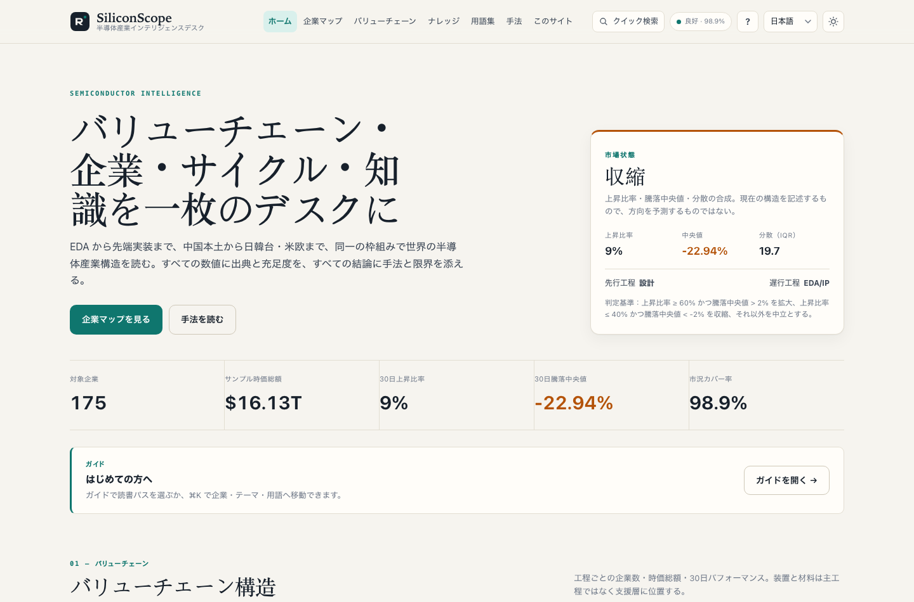
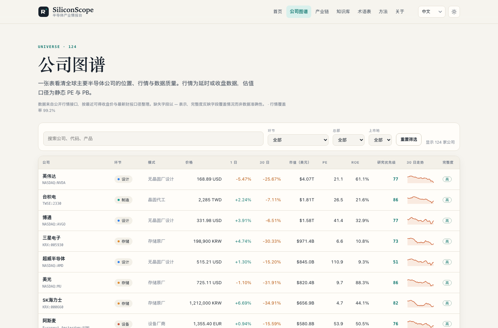
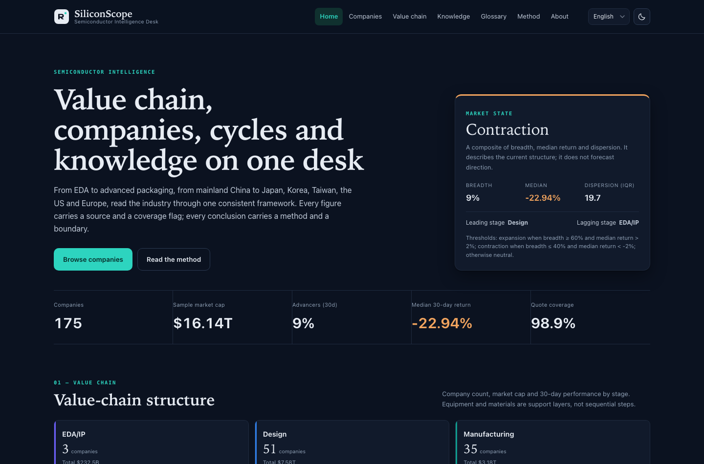
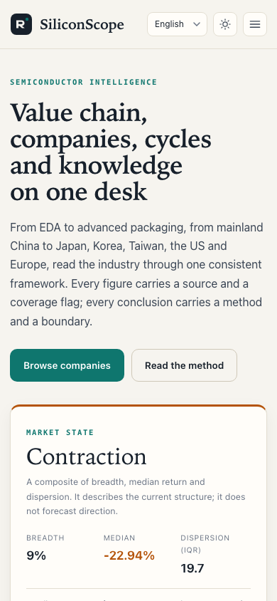
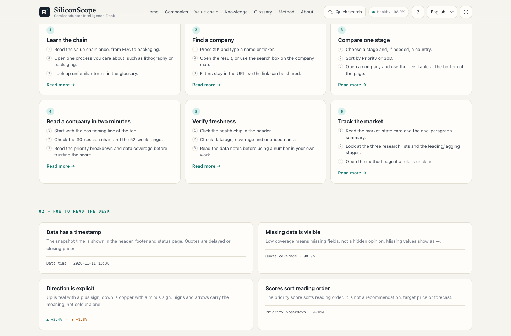
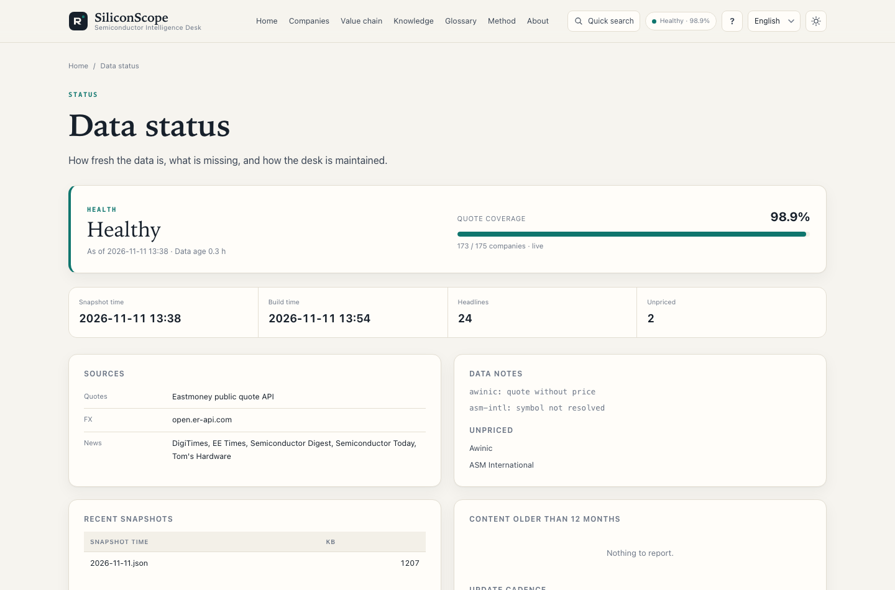

# SiliconScope · 半導体インテリジェンス・デスク

**グローバルな半導体バリューチェーンを対象とした4言語のリサーチデスクです。**

SiliconScopeは、**8つのバリューチェーン段階、13の本社地域、175社の上場企業**を対象とし、相場、構造、知識、手法を検証可能な1つのデスクに集約しています。各ページはビルド時に生成される静的ファイルであり、サイトはCDNにもフロントエンドフレームワークにも依存しません。

- サイト（英語、デフォルト）：<https://cxy2696.github.io/semiconductor/>
- 中文：<https://cxy2696.github.io/semiconductor/zh/>
- 日本語：<https://cxy2696.github.io/semiconductor/ja/>
- Deutsch：<https://cxy2696.github.io/semiconductor/de/>
- リポジトリ：<https://github.com/cxy2696/semiconductor>

> 本サイトは業界調査と学習のみを目的としています。投資助言ではありません。


---

## 目的

SiliconScopeはリサーチデスクであり、相場端末や銘柄選定ツールではありません。読者が1つのバリューチェーン段階または1社について、10〜30分で構造的な見方を組み立てられるようにし、その見方の根拠となるデータがどれだけ揃っているかを明確に示します。相場、分類、長文解説、スコアリング手法をまとめて公開しているため、すべての数値をスナップショットファイルとフィールド定義まで遡って確認できます。

---

## プレビュー





| ダークモード | モバイル |
| --- | --- |
|  |  |

| ガイド | データ状態 |
| --- | --- |
|  |  |


---

## 作り直した理由

旧版はA株を中心とした中国語ダッシュボードで、1,000行の単一ファイルスクリプト、CDNから読み込むTailwindとPlotly、スクレイピング失敗をビルド失敗として扱う設計、非公開のスコアリングルールを抱えていました。v2ではプロダクトロジックとエンジニアリング構造を作り直しました。v3ではデフォルト言語を英語に移し、ドイツ語を追加し、対象を124社から175社に広げ、4言語コンテンツをリポジトリで継続的に保守する対象にしました。

| 項目 | v1 | v2 | v3（現在） |
| --- | --- | --- | --- |
| カバレッジ | 中国A株 + 香港上場2銘柄 | 124社、7つの上場市場 | **175社、13の本社地域、7つの上場市場** |
| 言語 | 中国語 / 英語 / ドイツ語 | 中国語 / 英語 / 日本語 | **英語（デフォルト） / 中国語 / 日本語 / ドイツ語** |
| ナレッジ | 百科事典の段落をスクレイピング | 9トピック × 3言語 | **12トピック × 4言語 + 4言語の用語52件** |
| スコアリング | 非公開の重み | 公開された手法 | 公開された手法 + データ充足度 + リスクフラグ |
| フロントエンド | CDN + 実行時レンダリング | 静的HTML/SVG | 静的HTML/SVG、サードパーティ資産ゼロ |
| データ | スクレイピング失敗 = ビルド失敗 | スナップショットによるフォールバック | スナップショットによるフォールバック + 陳腐化フラグ + カバレッジ |
| ドキュメント | なし | 主に中国語 | **すべてのドキュメントを `_en` / `_cn` / `_jp` / `_de` で提供** |

## 機能

- **ホーム**：市場状態の指標（ブレッドス / 中央値リターン / 分散）、バリューチェーン構造、モメンタムの両極、バリュエーションと品質の散布図、公開ルールに基づく3つのスクリーニング、業界ニュースを表示します。
- **企業マップ**：175社を対象に、段階・本社・上場市場による絞り込みと並べ替えができ、30日間の推移、PER/PBR/ROE、研究優先度、データ充足度も表示します。
- **企業ページ**：ポジショニング、相場、52週レンジ、設立年と決算期末、ファクター内訳、同業比較、関連情報を掲載しています。
- **バリューチェーン**：6つの主要フロー段階に、製造装置と材料の支援層を加えた構成です。各セグメントについて、どのように収益を上げ、どの指標が重要で、誰が競争しているかを説明します。
- **ナレッジベース**：4言語で提供する12件の長文トピックです。バリューチェーン、ウェハプロセス、リソグラフィ、製造装置と材料、先端実装、メモリとHBM、シリコンサイクル、政策、財務とバリュエーションに加え、新たにEDA/IP、自動車、AIデータセンターを扱います。
- **用語集**：4言語で同等の定義を持つ52件の用語を収録し、全文検索とカテゴリフィルタを備えています。
- **手法**：ファクターの定義、重み、しきい値、データ充足度、既知の制約、免責事項を掲載しています。
- **ガイド**：3つの読書パス、数字の前提、1分でわかるサイトマップ（`/ja/guide.html`）。
- **クイック検索**：⌘K / Ctrl-K で企業・テーマ・用語・ページへ移動。
- **データ状態**：`/ja/status.html` で鮮度・充足度・出典・注記を確認。`python -m semcore status` も同じ要約を出力します。
- **互換性**：従来の `latest_data.json` を引き続き出力するため、既存のiOSクライアントは変更なしでデコードできます。
- **iOSクライアント**：`ios/` 配下のSwiftUIアプリは引き続き `latest_data.json` を参照しています。詳細は [`ios/README_jp.md`](ios/README_jp.md) を参照してください。

## クイックスタート

```bash
python -m venv .venv
source .venv/bin/activate
pip install -r requirements-dev.txt

# Build from the committed snapshot (no network required)
python -m semcore build
python -m semcore serve --port 8000

# Fetch the latest quotes / FX / news and rebuild
python -m semcore refresh

# Validate the data contract and generated artefacts
python -m semcore validate

# Tests
python -m pytest
```

ビルド出力は `docs/` に生成されます：`docs/index.html`（英語）、`docs/zh/`、`docs/ja/`、`docs/de/`、`docs/api/`、`docs/latest_data.json`、および `docs/en/` 配下のリダイレクトスタブです。このディレクトリは生成物であり git の管理外で、GitHub Actions がビルドして配備します。

## ディレクトリ構成

```text
semcore/                 Python build tooling (fetch → analyse → render)
  sources/               Eastmoney quotes, RSS news, FX
  analytics.py           factors, research priority, risk flags, market state
  build.py               four-locale static site generation
  validate.py            data contract and artefact validation
  content.py             minimal Markdown renderer and content loading
data/
  universe.csv           175-company master data (part of the source of truth)
  taxonomy.json          stage / role / product / country / market labels (four languages)
  glossary.json          52 terms in four languages
  i18n/{en,zh,ja,de}.json interface copy
  symbols.json           verified company → quote-source symbol mapping
  snapshots/             market snapshots (the only build input)
content/knowledge/       12 topics × 4 languages (flat: <slug>_en.md etc.)
templates/               Jinja2 templates
assets/                  design-system CSS + native JS (no dependencies)
docs/                    生成サイト（ローカルと CI で生成、git 管理外）
documentation/           product / architecture / data / method / operations docs (four languages)
ios/                     SwiftUI iPhone client
tests/                   pytest suite
```

## iOSクライアント

`ios/` は元のSwiftUIアプリであり、引き続き `docs/latest_data.json` を利用しています。v3はこのペイロードを維持し、フィールド単位の互換性チェック（175社、nullでないOHLC配列）を行っているため、既存クライアントは変更なしでデコードを続けられます。

```bash
brew install xcodegen
cd ios && xcodegen generate --spec project.yml
open SemiconductorApp.xcodeproj
```

シミュレータ、署名、TestFlightの手順については [`ios/README_jp.md`](ios/README_jp.md) を参照してください。

## データと定義

- **相場、バリュエーション、52週レンジ**：Eastmoneyの公開相場API（遅延価格または終値）。
- **為替**：open.er-api.com。利用できない場合はEastmoneyの為替ペア、さらに前回のスナップショットへフォールバックします。
- **業界ニュース**：許可リストに登録されたメディアのRSSフィード。保持するのはタイトル、配信元、日付、リンクのみです。
- **スナップショット**：`data/snapshots/latest.json` が唯一のビルド入力です。取得に失敗してもサイトは空にならず、前回のデータに `stale` を付けて表示します。
- **分類**：1社につき主上場市場は1つです。各社は主な収益源に基づいて8つの段階のいずれかに割り当てられます。タクソノミーには9つの役割、70の製品タグ、13の本社地域、7つの上場市場も定義されています。
- **企業詳細**：`data/universe.csv` には4言語の企業名と注記、さらに任意項目の `founded` と `fiscal_year_end` が含まれ、企業ページに表示されます。
- フィールドの詳細、単位、制約については [`documentation/DATA_en.md`](documentation/DATA_en.md) を参照してください。

## スコアリングの概要

```text
research priority = 0.30 × quality (ROE percentile)
                  + 0.25 × valuation (inverse static PE percentile)
                  + 0.25 × momentum (30-day return 60% + 52-week range position 40%)
                  + 0.20 × size (log market-cap percentile)
```

- パーセンタイルは同じ段階内で計算します。企業数が8社未満の段階では、全サンプルを対象にフォールバックします。
- 欠損したファクターは残りの重みで再正規化し、スコアと併せてデータ充足度を報告します。
- スコアは**読む順序**を決めるためだけに使用します。売買助言、目標株価、業績予想ではありません。

計算式の詳細、しきい値、制約については [`documentation/METHODOLOGY_en.md`](documentation/METHODOLOGY_en.md) またはサイトの `/methodology.html` を参照してください。

## 4言語、英語を優先

- 英語はサイトルート `/` のデフォルト言語であり、`x-default` でもあります。
- 中国語は `/zh/`、日本語は `/ja/`、ドイツ語は `/de/` にあります。
- 各ページは4つの `hreflang` 代替を出力し、言語切り替え時も現在のページにとどまります。
- 従来の `/en/` リンクはルートパスへリダイレクトされるため、古いURLも壊れません。
- インターフェース文言は `data/i18n/{en,zh,ja,de}.json`、データラベルは `taxonomy.json`、長文コンテンツはフラット構成の `content/knowledge/<slug>_<suffix>.md` にあります。
- CIでは、インターフェースキー、ナレッジのスラッグ、用語集のフィールドが4言語すべてで揃っているかを検証します。

## ドキュメント

英語版が正典です。各ドキュメントには `_en`、`_cn`、`_jp`、`_de` の接尾辞を持つ4言語版があります。英語のREADMEはルートの `README.md` で、その他のREADMEは `README_cn.md`、`README_jp.md`、`README_de.md` です。

| ドキュメント | English | 中文 | 日本語 | Deutsch |
| --- | --- | --- | --- | --- |
| プロジェクトREADME | [README_en.md](README_en.md) | [README_cn.md](README_cn.md) | [README_jp.md](README_jp.md) | [README_de.md](README_de.md) |
| 製品 | [PRODUCT_en](documentation/PRODUCT_en.md) | [PRODUCT_cn](documentation/PRODUCT_cn.md) | [PRODUCT_jp](documentation/PRODUCT_jp.md) | [PRODUCT_de](documentation/PRODUCT_de.md) |
| アーキテクチャ | [ARCHITECTURE_en](documentation/ARCHITECTURE_en.md) | [ARCHITECTURE_cn](documentation/ARCHITECTURE_cn.md) | [ARCHITECTURE_jp](documentation/ARCHITECTURE_jp.md) | [ARCHITECTURE_de](documentation/ARCHITECTURE_de.md) |
| データ | [DATA_en](documentation/DATA_en.md) | [DATA_cn](documentation/DATA_cn.md) | [DATA_jp](documentation/DATA_jp.md) | [DATA_de](documentation/DATA_de.md) |
| 手法 | [METHODOLOGY_en](documentation/METHODOLOGY_en.md) | [METHODOLOGY_cn](documentation/METHODOLOGY_cn.md) | [METHODOLOGY_jp](documentation/METHODOLOGY_jp.md) | [METHODOLOGY_de](documentation/METHODOLOGY_de.md) |
| 運用 | [OPERATIONS_en](documentation/OPERATIONS_en.md) | [OPERATIONS_cn](documentation/OPERATIONS_cn.md) | [OPERATIONS_jp](documentation/OPERATIONS_jp.md) | [OPERATIONS_de](documentation/OPERATIONS_de.md) |
| ロードマップ | [ROADMAP_en](documentation/ROADMAP_en.md) | [ROADMAP_cn](documentation/ROADMAP_cn.md) | [ROADMAP_jp](documentation/ROADMAP_jp.md) | [ROADMAP_de](documentation/ROADMAP_de.md) |

同じ規則がナレッジファイルにも適用されます。ナレッジファイルは言語別ディレクトリに分けず、フラットに配置します：`content/knowledge/eda-ip_en.md`、`content/knowledge/eda-ip_cn.md`、`content/knowledge/eda-ip_jp.md`、`content/knowledge/eda-ip_de.md`。

## デプロイ

GitHub PagesはActionsワークフロー `.github/workflows/pages.yml` で運用しています：

1. リポジトリの Settings → Pages → Source で **GitHub Actions** を選択します。
2. ワークフローは毎日08:30（北京時間）と手動実行時に `python -m semcore refresh` を実行し、その後ビルド、検証、デプロイを行います。
3. 相場ソースが利用できない場合も、ワークフローは前回のスナップショットからビルドし、ページにデータのタイムスタンプを表示します。

`SITE_URL` 環境変数でcanonicalドメインを上書きできます（デフォルトは `https://cxy2696.github.io/semiconductor`）。

## コントリビューション

データの修正、用語集への追加、ドキュメントの改善を歓迎します。検証可能な出典を添え、変更の範囲を明記してください。詳細は [`CONTRIBUTING_en.md`](CONTRIBUTING_en.md) を参照してください。

## ライセンス

- コード：[MIT](LICENSE)
- 文書コンテンツ：CC BY 4.0
- 相場とニュース：著作権は元の提供者に帰属します。本サイトは引用とリンクのみを行います。

引用の際は **SiliconScope** とアクセス日を明記してください。

---

**免責事項**：本サイトは業界調査と学習のみを目的としており、証券の売買を推奨するものではありません。データは遅延したり誤っていたりする場合があります。必ず取引所への提出書類および企業の公表資料を優先してください。
